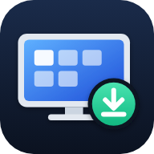

# TV-App-Transfer



Deployment- und Kompatibilitätswerkzeug für vom Nutzer rechtmäßig bereitgestellte Anwendungen auf unterstützten
Samsung-TV-Geräten. Es ist kompatibel mit ausgewählten Samsung Smart TVs und Android-TV-Geräten (z. B. Fire TV).
Das Programm gibt es für **Windows (EXE)** und **Android (APK)**, beide mit gleichem Funktionsumfang.

Sie wählen die zu verarbeitende Datei selbst aus. Das Programm stellt keine Apps Dritter bereit, verarbeitet Ihre Dateien
lokal und umgeht keine Schutzmaßnahmen (DRM, Lizenzprüfungen, Kopierschutz). Es wird nicht zugesichert, dass eine
bestimmte App umgewandelt werden kann.

> **Wichtig vorab:** Samsung-Fernseher laufen mit **Tizen**, nicht mit Android. Eine normale Android-App (APK)
> kann dort grundsätzlich nicht laufen. Das liegt nicht an diesem Programm, sondern am System.
> TV-App-Transfer prüft jede Datei und sagt Ihnen ehrlich, was möglich ist:
>
> | Ihre Datei | Was passiert |
> |---|---|
> | eigene App des Anbieters mit Samsung-Fassung (z. B. **PowerIPTV**) | die Samsung-Fassung wird geladen, für Ihren Fernseher signiert und installiert |
> | APK aus Web-Technik (Cordova, PhoneGap, Capacitor, Ionic) | wird zur Samsung-App umgewandelt und installiert |
> | APK, die nur eine Webseite anzeigt (WebView-Hülle) | die Webseite wird als Samsung-App verpackt und installiert |
> | Webadresse (Web-Player, Mediathek …) | wird als eigene App auf dem Fernseher angelegt |
> | Tizen-App (`.wgt` / `.tpk`) | wird für Ihren Fernseher signiert und installiert |
> | normale Android-App (Java/Kotlin, Flutter, React Native, Unity …) | **nicht** für Samsung umwandelbar → kann unverändert auf ein **Android-TV-Gerät** (Fire TV, Google TV) übertragen werden |
> | App mit Lizenz- oder Kopierschutz | wird **nicht** umgewandelt (das würde den Schutz umgehen) → nur unverändert auf ein Android-TV-Gerät |

## Downloads

Immer die aktuelle Version (Seite mit allen Dateien): https://github.com/Schnielz87/Samsung-TV-App-Konverter-Transfer/releases/latest

| Gerät | Datei |
|---|---|
| Windows-PC (Installer) | [**TV-App-Transfer-Setup.exe**](https://github.com/Schnielz87/Samsung-TV-App-Konverter-Transfer/releases/latest/download/TV-App-Transfer-Setup.exe) |
| Windows-PC (ohne Installation) | [TV-App-Transfer-Portable.zip](https://github.com/Schnielz87/Samsung-TV-App-Konverter-Transfer/releases/latest/download/TV-App-Transfer-Portable.zip): entpacken und `TV-App-Transfer.exe` starten |
| Android-Handy/Tablet | [**TV-App-Transfer.apk**](https://github.com/Schnielz87/Samsung-TV-App-Konverter-Transfer/releases/latest/download/TV-App-Transfer.apk) |

- **PC:** Führen Sie das Setup aus. Bei der Windows-Warnung klicken Sie auf „Weitere Informationen“ und dann auf „Trotzdem ausführen“.
- **Handy:** Tippen Sie die APK an und installieren Sie sie. Dafür müssen Sie einmalig „Installation aus unbekannten Quellen“ erlauben.

### Updates

Beide Apps prüfen automatisch alle 24 Stunden, ob es eine neue Version gibt. Sie können auch jederzeit unten im Programm
auf **Nach Updates suchen** klicken. Gibt es eine neue Version, erscheint oben ein Hinweis. Ein Klick auf
**Jetzt aktualisieren** lädt die neue Version und startet die Installation:

- **Windows:** Der Installer startet, und das Programm schließt sich dafür kurz.
- **Android:** Der Android-Installer öffnet sich. Beim ersten Mal fragt Android, ob TV-App-Transfer Apps
  installieren darf. Erlauben Sie das, kehren Sie zurück und tippen Sie erneut auf „Jetzt aktualisieren“.

Ihre Samsung-Zertifikate, gespeicherten Geräte und Einstellungen bleiben bei jedem Update erhalten.

## Schritt-für-Schritt-Anleitung

Diese Anleitung finden Sie auch in der App unter **Anleitung** (ganz oben).


### Einmalig: Fernseher vorbereiten

- Fernseher und Handy bzw. PC müssen im selben WLAN sein.
- Am Fernseher die Home-Taste drücken, unten ganz links "Apps" öffnen. Auf diesem Bildschirm bleiben (keine App anwählen).
1 2 3 4 5 eingeben: mit Zifferntasten direkt; bei der schmalen Fernbedienung die Taste "123" drücken bzw. gedrückt halten und die Ziffern im Bildschirm-Ziffernfeld wählen; alternativ in der SmartThings-App auf dem Handy (Fernbedienung → 123).
- Im Fenster "Entwicklermodus" den Schalter auf EIN stellen und bei "Host PC IP" die IP-Adresse eintragen, die TV-App-Transfer unter "Wohin?" beim Fernseher anzeigt (die IP DIESES Geräts). OK drücken.
- Fernseher richtig neu starten: Ein/Aus-Taste der Fernbedienung gedrückt halten, bis das Samsung-Logo erscheint.
- Wichtig: Am Fernseher kann immer nur eine IP stehen. Wechseln Sie zwischen Handy und PC, muss die IP dort umgestellt werden.

### Einmalig: Samsung-Konto

- Sie brauchen ein kostenloses Samsung-Konto (falls nicht vorhanden: auf account.samsung.com anlegen).
- Bei der ersten Installation öffnet sich die Samsung-Anmeldung im Browser. Dort anmelden und danach zur App zurückkehren – das Zertifikat wird dann automatisch erstellt und gespeichert.
- Werbe- oder Tracking-Filter (Privates DNS, AdGuard, Pi-hole) können die Samsung-Adressen blockieren. Die App umgeht das in der Regel selbst; sonst den Filter für die Einrichtung kurz ausschalten.

### Jedes Mal: App auf den Fernseher bringen

1. Was? Datei wählen (APK, .wgt), eine installierte App vom Handy wählen oder eine Webadresse eingeben. Die App zeigt sofort, ob sie für Samsung umwandelbar ist (grüner Punkt).
2. Wohin? "Im WLAN suchen" drücken und den Fernseher antippen. Erscheint ein gelber Hinweis, diesen zuerst erledigen (meist: falsche IP am Fernseher).
3. Modelljahr prüfen (wird meist automatisch erkannt).
4. "Auf den Samsung-Fernseher übertragen" drücken. Beim ersten Mal öffnet sich die Samsung-Anmeldung – anmelden, zurück zur App, warten.
5. Fertig, wenn "ist auf dem Fernseher installiert" erscheint. Die App finden Sie am Fernseher unter Apps (ganz unten / in der App-Leiste).

### Android-Stick (Fire TV, Google TV) statt Samsung

- Für Apps, die nicht umwandelbar sind: Am Stick Einstellungen → Mein Fire TV → Info → 7× auf den Namen tippen → Entwickleroptionen → ADB-Debugging EIN.
- In der App "Im WLAN suchen", den Android-Stick wählen, übertragen. Am Fernseher "USB-Debugging zulassen" mit "Immer zulassen" bestätigen.

### Wenn etwas nicht klappt

- Unten im Protokoll auf "Kopieren" tippen und den Text an den Support schicken.
- "Verbindung beendet / nur das Gerät mit der IP … herein": IP am Fernseher stimmt nicht – siehe "Fernseher vorbereiten".
- "Zertifikat passt nicht": Unter "Wohin?" erneut übertragen und bei Samsung anmelden; das Zertifikat wird neu erstellt.

## Einmalige Vorbereitung am Samsung-Fernseher (ca. 2 Minuten)

1. Fernseher und PC bzw. Handy müssen im selben WLAN sein.
2. Öffnen Sie am Fernseher **Apps**.
3. Geben Sie auf der Fernbedienung nacheinander **1 2 3 4 5** ein.
4. Stellen Sie den **Entwicklermodus** auf **EIN**. Tragen Sie bei „Host PC IP“ die IP-Adresse des PCs bzw. Handys ein.
   Das Programm zeigt Ihnen diese Adresse unter „Anleitung: Entwicklermodus …“ an.
5. Starten Sie den Fernseher neu: Ein/Aus-Taste ca. 3 Sekunden halten, bis das Samsung-Logo erscheint.

Tipp: Am Fernseher kann immer nur **eine** Host-IP eingetragen sein. Wenn Sie abwechselnd vom PC und vom Handy
installieren, müssen Sie die IP dort jeweils umstellen.

## Einmalige Vorbereitung am Android-Stick (Fire TV / Google TV)

1. Öffnen Sie **Einstellungen → Mein Fire TV** (bzw. **Info**) und tippen Sie 7× auf den Gerätenamen.
   Damit erscheinen die **Entwickleroptionen**.
2. Schalten Sie dort **ADB-Debugging** ein (Google TV: **USB-Debugging**).
3. Beim ersten Übertragen erscheint am Fernseher „USB-Debugging zulassen?“.
   Setzen Sie den Haken bei **Immer zulassen** und bestätigen Sie mit **OK**.

## Bedienung

1. **Was?** Ziehen Sie eine Datei ins Fenster, klicken Sie auf **Datei wählen** oder geben Sie eine Webadresse ein.
   Auf dem Handy gibt es zusätzlich **Installierte App vom Handy**: Damit überträgt das Programm eine bereits
   installierte App inklusive aller Teile. Außerdem können Sie Dateien über **Teilen → TV-App-Transfer** schicken.
2. **Wohin?** Klicken Sie auf **Im WLAN suchen** oder geben Sie die IP-Adresse ein. Wählen Sie dann den Fernseher oder Stick aus.
   Beim Samsung-Fernseher wird das **Modelljahr** automatisch erkannt. Sie können es auch selbst wählen (2017 bis 2026).
3. Klicken Sie auf **Übertragen**. Das Programm wandelt die Datei um, signiert sie, überträgt sie und installiert sie.

### Der Konverter: so arbeitet er

Für Sie läuft es wie bei einem Dateikonverter ab: **Datei wählen → Konvertieren → Samsung-App (.wgt) erhalten → optional
direkt auf den eigenen Fernseher installieren**. Kenntnisse über Tizen Studio, config.xml oder Signaturen brauchen Sie nicht.

Im Hintergrund durchläuft jede Datei diese Schritte:

1. **Erkennen und entpacken:** APK, APK-Bündel (.apks/.xapk), Tizen-App oder Webadresse.
2. **Analysieren:** Architektur, Oberfläche, Ressourcen, Web-Inhalte, Netzwerk, Medien, Schnittstellen und Abhängigkeiten.
   Das Ergebnis sehen Sie im **Analysebericht**. Jeder Punkt ist dort markiert als *übertragbar* (grün),
   *eingeschränkt* (gelb) oder *nicht portierbar* (rot).
3. **Übernehmen und anpassen:** Kompatible Bestandteile (Web-Inhalte, Symbol, Internetzugriff) werden übernommen. Für die
   Samsung-Fernbedienung wird eine Steuerungshilfe ergänzt (Pfeiltasten, OK, Zurück).
4. **Erzeugen:** config.xml, App-ID, Symbol, Berechtigungen und Metadaten.
5. **Prüfen:** Das Paket wird vor dem Signieren geprüft, etwa auf eine gültige config.xml, die Startseite und eingebundene Dateien.
6. **Signieren:** mit Ihrem Samsung-Entwicklerzertifikat (offizielle Samsung-Zertifizierungsstelle).
7. **Installieren** (optional) über den Samsung-Entwicklermodus inklusive Installationsfreigabe.

**Keine falschen Erfolgsmeldungen:** Lässt sich eine App nicht automatisch portieren, nennt das Programm den konkreten
Grund. Ein Beispiel: „Konvertierung nicht möglich: Die App verwendet Android-Bestandteile ohne Tizen-TV-Entsprechung
(Media3/ExoPlayer; Google-Play-Dienste)“. Ein Paket, das die Prüfung nicht besteht, wird nie als „erfolgreich konvertiert“
ausgegeben. Funktionieren Teile nur eingeschränkt, steht das ausdrücklich in der Erfolgsmeldung.

Hinweis zur Technik: Das Programm baut und signiert die Pakete selbst, im selben Format wie Samsungs Tizen Studio. Das
offizielle Tizen Studio (mehrere GB, nur für PCs) wird dafür nicht benötigt. Die Installation läuft über Samsungs
Entwicklermodus.

### Samsung-Zertifikat

Samsung-Fernseher installieren im Entwicklermodus nur Apps, die mit einem **Samsung-Entwicklerzertifikat** signiert sind.
In diesem Zertifikat ist die Geräte-ID des Fernsehers eingetragen. Bei der ersten Installation öffnet sich im Browser
die offizielle Samsung-Anmeldung. Melden Sie sich dort mit Ihrem kostenlosen Samsung-Konto an. Ihr Passwort geben Sie
nur bei Samsung ein, das Programm sieht es nie. Das Zertifikat wird danach auf Ihrem Gerät gespeichert, und jede weitere
Installation läuft ohne Anmeldung. Kommt ein weiterer Fernseher dazu, erweitert das Programm das Zertifikat automatisch.

Andere Tizen-Apps (`.wgt`), etwa offene Projekte, laden Sie selbst von der Quelle Ihres Vertrauens herunter und wählen
sie als Datei aus. Das Programm enthält keine eingebauten Downloads fremder Apps.

### Häufige Probleme

Mit dem Knopf **Kopieren** über dem Protokoll übernehmen Sie das ganze Protokoll in die Zwischenablage, z. B. um es dem Support zu schicken.

| Meldung | Lösung |
|---|---|
| „Die Adresse … wird in Ihrem Netz blockiert“ / „Unable to resolve host svdca.samsungqbe.com“ | Ein Werbefilter (Privates DNS am Handy, AdGuard, Pi-hole, Router-Filter) sperrt die Samsung-Zertifizierungsstelle. Die App weicht seit 1.0.9 automatisch auf verschlüsseltes DNS aus. Klappt es trotzdem nicht: Filter kurz ausschalten (Android: Einstellungen → Verbindungen → Weitere Verbindungseinstellungen → Privates DNS → Aus). Mobile Daten helfen nicht, weil der Fernseher im WLAN erreichbar sein muss. |
| Samsung-Anmeldeseite bleibt weiß / lädt nicht weiter | Seite neu laden oder im Anmeldefenster der App auf „Anmeldeseite erneut öffnen“ tippen. Werbe- und Trackingfilter (Privates DNS, Werbeblocker in Samsung Internet) blockieren oft die Sicherheitsprüfung (reCAPTCHA) der Samsung-Seite, schalten Sie sie dann kurz aus. Alternativ mit „Link kopieren“ die Seite in Chrome öffnen. Lassen Sie TV-App-Transfer dabei geöffnet. |
| „Der Fernseher lässt nur das Gerät mit der IP … herein“ | Am Fernseher ist die IP eines anderen Geräts eingetragen (z. B. die des PCs). Tragen Sie unter Apps → 1 2 3 4 5 die angezeigte IP dieses Geräts ein und starten Sie den Fernseher neu. Oder starten Sie die Übertragung von dem Gerät, dessen IP eingetragen ist. |
| „Fernseher lässt keine Verbindung zu“ | Entwicklermodus an? Stimmt die Host-IP (siehe Programm)? Fernseher danach neu gestartet? |
| „Code 118012“ / Fernseher lehnt Zertifikat ab | Seit 1.0.17 überträgt die App vor jeder Installation automatisch das von Samsung unterschriebene Geräteprofil (wie „Permit to install“ in Tizen Studio). Dafür ist einmalig eine neue Samsung-Anmeldung nötig. Bleibt der Fehler, ist meist ist die App auf dem Fernseher schon installiert, aber mit einem anderen Zertifikat (z. B. früher über Tizen Studio oder USB). Löschen Sie die App am Fernseher (Apps → App auswählen → Optionen → Löschen) und übertragen Sie erneut. Zum Testen können Sie auch eine Webadresse übertragen: Klappt das, liegt es an der vorhandenen App. |
| „Zertifikat passt nicht“ | Bei Samsung erneut anmelden, das Programm erstellt das Zertifikat dann neu. Bei einem neuen Fernseher geschieht das automatisch. |
| Web-App zeigt nur Schwarz | Ältere Fernseher (2017–2019) haben einen alten Browser. Moderne Web-Apps laufen dort teilweise nicht. |
| Stick: „nicht erreichbar“ | Ist ADB-Debugging eingeschaltet? Ist der Stick im selben WLAN? |
| Stick: „Zugriff nicht bestätigt“ | Am Fernseher „USB-Debugging zulassen“ mit OK bestätigen. |

### Apps mit eigener Samsung-Version

Für manche Apps gibt es eine eigene Samsung-Fassung. Bei **PowerIPTV** liegt sie im Ordner „Tizen Samsung“ und in jedem
PowerIPTV-Release. Wählen Sie diese App (als APK oder unter „Installierte App vom Handy“), lädt das Programm
automatisch die neueste Samsung-Fassung, signiert sie und installiert sie auf dem Fernseher. Weitere Apps lassen sich in
`core/src/main/kotlin/de/tvtransfer/convert/TizenCounterparts.kt` ergänzen.

## Symbol & Grafiken

Das App-Symbol liegt als Vektorgrafik in `branding/icon.svg` (Vordergrund für adaptive Android-Symbole:
`branding/icon-foreground.svg`). Fertige Größen stehen in `branding/png/` (16 bis 1024 px), das Web-Symbol in
`branding/favicon.ico`. Neu erzeugen mit `node branding/render.cjs branding/icon.svg <ziel> 512 192 …`.

## Rechtliches

- **Rechte-Bestätigung:** Vor der ersten Verarbeitung bestätigen Sie, dass Sie berechtigt sind, die gewählte Software zu
  verwenden, zu verarbeiten und zu installieren. Diese Bestätigung ist Teil der Nutzungsbedingungen.
- **Nutzungsbedingungen, Datenschutz, Lizenzen und Anbieter** stehen in der App unter **Rechtliches**.
- **Datenschutz:** Das Programm verarbeitet alles lokal. Es gibt keine Telemetrie, und es überträgt keine Namen oder
  Dateien Ihrer Apps an den Anbieter. Zwischendateien werden nach jedem Vorgang gelöscht.
- Samsung und Tizen sind Marken ihrer jeweiligen Rechteinhaber. Dieses Produkt ist ein unabhängiges Softwarewerkzeug und
  steht in keiner Verbindung zu Samsung, sofern nicht ausdrücklich anders angegeben.
- Verbindliche Produktregeln für die Entwicklung: [docs/RECHTLICHE_LEITPLANKEN.md](docs/RECHTLICHE_LEITPLANKEN.md)

## Technik (für Entwickler)

```
core/       gemeinsame Logik (reines Kotlin/JVM): Analyse, Umwandlung, Signatur, sdb/adb-Protokoll, Samsung-Zertifikate
shared-ui/  gemeinsame Oberfläche (Compose), wird von Windows- und Android-App mitkompiliert
desktop/    Windows-Programm (Compose Desktop, Installer über jpackage)
android/    Android-App (Jetpack Compose)
```

- **Samsung:** sdb-Protokoll (Port 26101). Upload nach `/home/owner/share/tmp/sdk_tools/`, Installation mit `vd_appinstall`.
  Die Geräte-ID kommt über `getduid`, Geräteinfos über `http://<TV>:8001/api/v2/`.
- **Signatur:** XML-DSig für Widgets (`author-signature.xml` und `signature1.xml`, SHA-512 / RSA-SHA512, Exclusive C14N).
  Die Tests prüfen sie mit Javas Standard-XML-Signaturprüfung.
- **Zertifikate:** Die Zertifikatsanfragen (CSR) entstehen lokal. Die Samsung-Zertifizierungsstelle für TV („VD“) signiert sie.
  Die öffentlichen Samsung-Zwischenzertifikate stammen aus der Samsung Certificate Extension für Tizen Studio
  (`core/src/main/resources/de/tvtransfer/ca/`).
- **Android-Stick:** adb über WLAN (Port 5555) mit eigener RSA-Anmeldung. Upload per Sync-Protokoll, Installation mit
  `pm install`, bei geteilten APKs `pm install-create/-write/-commit`.
- **Umwandlung:** Web-Inhalte aus `assets/www` bzw. `assets/public` werden übernommen. Eine `config.xml` für das
  Profil `tv-samsung` wird erzeugt. `cordova.js` wird durch einen Ersatz ersetzt, und `tv-bridge.js` sorgt für die
  Steuerung mit der Fernbedienung (Pfeiltasten, OK, Zurück).

Bauen und Testen:

```bash
gradle :core:test                 # Tests (ohne Android SDK)
gradle :desktop:run               # Windows-/Desktop-Programm starten
gradle :desktop:packageExe        # Windows-Installer (auf Windows)
gradle :android:assembleRelease   # APK (Android SDK nötig)
```

**Versionen & Updates (Schema wie PowerIPTV/Portiva):** Die Version lautet `1.0.<Laufnummer>` von `.github/workflows/build.yml`.
Benennen Sie diese Datei nie um, sonst beginnt die Zählung neu. Jeder Push erzeugt in diesem Repo das Release
`tv-app-transfer-v1.0.<Lauf>`, und dort suchen die Apps nach Updates (`UpdateChecker.REPO`). Das Repo muss deshalb
öffentlich bleiben. Die festen Dateinamen (`UpdateChecker.APK_NAME`, `WINDOWS_SETUP_NAME`) dürfen nicht geändert werden.

Die APK ist mit dem festen Schlüssel `android/signing/sideload.jks` signiert, damit sich Updates über die alte Version installieren lassen.
Optional ersetzen die Secrets `ANDROID_KEYSTORE_BASE64`, `ANDROID_KEYSTORE_PASSWORD`, `ANDROID_KEY_ALIAS` und
`ANDROID_KEY_PASSWORD` diesen Schlüssel. Achtung: Ein Schlüsselwechsel erfordert einmalig eine Neuinstallation.
